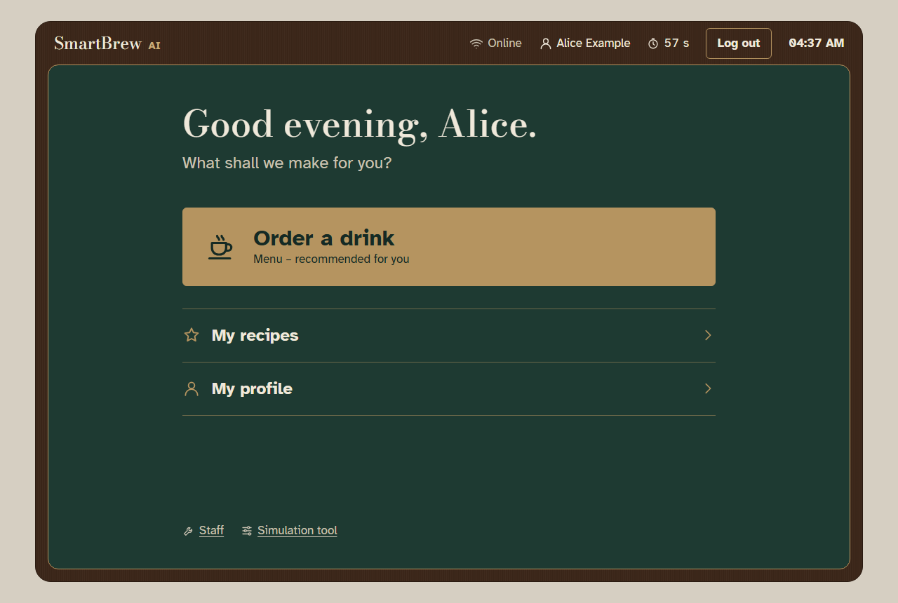
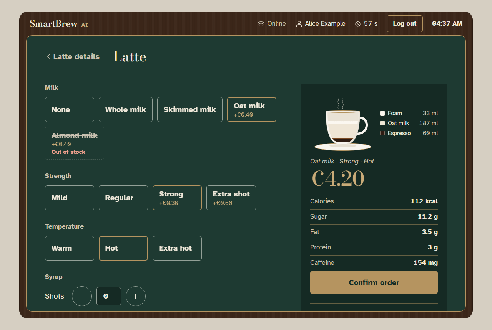

# SmartBrew AI – Prototype

A browser prototype of **SmartBrew AI**, an AI-powered coffee machine for
offices and hotel lounges. The web app imitates the machine's touchscreen.
All hardware and outside services (card reader, NFC reader, bank, weather,
email, sensors) are simulated, so it runs on any computer without API keys.

University project: Lab Assignment 3, Task B (implementation) and Task C
(documentation). Requirement IDs (FR-xx, NFR-xx) come from the Task A
requirements document.

## Table of contents

1. [System Overview](#1-system-overview)
2. [Environment & Prerequisites](#2-environment--prerequisites)
3. [Execution Guide](#3-execution-guide)
   - [3.1 Build and run with Docker (recommended)](#31-build-and-run-with-docker-recommended)
   - [3.2 Build and run locally](#32-build-and-run-locally)
   - [3.3 Run the tests](#33-run-the-tests)
   - [3.4 Demo data](#34-demo-data)
   - [3.5 The Simulation tool](#35-the-simulation-tool)
   - [3.6 Testing the 10 features](#36-testing-the-10-features)
4. [Code Documentation](#4-code-documentation)
5. [Design Notes](#5-design-notes)
6. [Known Limitations](#6-known-limitations)
7. [Project Structure](#7-project-structure)
8. [LLM Usage](#8-llm-usage)

---

## 1. System Overview

SmartBrew AI lets a customer choose and customize a drink on a touchscreen,
pay with a card, phone or employee card, and get a receipt. It recommends
drinks from the time of day, the weather and the customer's history, keeps
track of ingredients and waste, keeps working when the network is down, and
has a service mode for technicians.

| Home screen | Customizing a drink |
|---|---|
|  |  |

More screenshots (desktop and phone width) are in
[docs/screenshots/](docs/screenshots/).

### The 10 implemented features

| # | Feature | Requirement IDs |
|---|---|---|
| 1 | Accounts and login: create account, log in with password or NFC card, session ends after 60 s of inactivity or after a purchase | FR-01–03, NFR-09, NFR-14 |
| 2 | Menu browsing by category with nutritional information | FR-11, FR-12 |
| 3 | Live drink customization (milk, strength, temperature, syrup) with price, nutrition and a drawn cup updating; out-of-stock options blocked | FR-13, FR-65 |
| 4 | Inventory-aware ordering: low ingredients block drinks, stock is checked again before dispensing, deducted after, low-stock events | FR-14, FR-26–28, FR-66, FR-67 |
| 5 | Saved recipes: save, rename, edit, delete, one-touch ordering | FR-07–10, FR-15, NFR-24 |
| 6 | Personalized recommendations from time of day, weather and history; top 3 highlighted; works without weather | FR-16–18, FR-22–25, FR-56 |
| 7 | Payments: card (chip / contactless), Apple Pay / Google Pay, prepaid employee card; declines; never charged twice; refunds | FR-31–35, FR-62, NFR-08, NFR-27 |
| 8 | Offline fallback: offline mode, store-and-forward card payments, automatic sync, dropped-connection handling | FR-53–55, FR-58, FR-59, FR-61, NFR-29, NFR-30 |
| 9 | Receipts: QR code on screen and email receipt (queued while offline) | FR-36, FR-37, FR-60 |
| 10 | Service mode: PIN with lockout, NFC master card or service key; ingredients, waste bins, errors, event log, audit log | FR-43–52, FR-63, FR-64, NFR-12, NFR-13, NFR-27, NFR-31, NFR-37, NFR-41 |

Every completed order is also saved in the customer's order history
(FR-05, FR-06).

---

## 2. Environment & Prerequisites

### Runtime and tools

| Tool | Version used | Notes |
|---|---|---|
| Python | 3.12 (tested with 3.12.10) | Only needed to run without Docker |
| Docker | 29.9.2 | Any recent Docker Desktop or Docker Engine should work |
| Docker Compose | v5.6.1 | The `docker compose` command (Compose v2 or newer) |
| Web browser | Any current browser | Tested with Microsoft Edge |

### Libraries

All packages are pinned to exact versions in `requirements.txt` (including
the indirect ones), so every machine installs the same set.

| Library | Version | Used for |
|---|---|---|
| Flask | 3.1.3 | Web framework (app factory, blueprints, Jinja2 templates) |
| Flask-SQLAlchemy | 3.1.1 | Database access |
| SQLAlchemy | 2.1.6 | ORM for the SQLite database |
| bcrypt | 5.0.0 | Hashing passwords and the technician PIN (NFR-09) |
| qrcode[pil] / Pillow | 8.2 / 13.0.0 | QR receipts |
| pytest | 9.2.0 | Automated tests |

Indirect dependencies (also pinned): Werkzeug 3.1.9, Jinja2 3.1.6,
MarkupSafe 3.0.4, itsdangerous 2.2.0, click 8.5.0, blinker 1.9.0,
iniconfig 2.3.1, packaging 26.3, pluggy 1.7.0, Pygments 2.21.0,
typing_extensions 4.16.0 and colorama 0.4.6 (Windows only).

### External dependencies

**None.** There are no external services and no API keys. The card
processor, wallets, weather service, email and all machine hardware are
simulated inside the app. The fonts are bundled in `app/static/fonts/`, so
the app also works completely offline.

### Tested operating systems

- **Windows 11**: run locally with Python and with Docker Desktop.
- **Linux**: inside the Docker container (Debian-based `python:3.12-slim`),
  where all tests pass too.

Because it runs in Docker, it should run the same on any system with Docker.
The macOS/Linux commands in 3.2 are standard but were not tested on a Mac.

---

## 3. Execution Guide

### 3.1 Build and run with Docker (recommended)

1. Install Docker Desktop (Windows/macOS) or Docker Engine with Compose
   (Linux) and start it. You also need Git.
2. Get the code and open the project folder:

   ```powershell
   git clone https://github.com/ranaarauf1/Smart_Brew_AI.git
   cd Smart_Brew_AI
   ```

   (If you download the ZIP from GitHub instead, the folder is called
   `Smart_Brew_AI-main`; open a terminal in that folder.)
3. Build and start the app:

   ```powershell
   docker compose up --build
   ```

4. Open **http://localhost:5000** in your browser.

On the first start the database is created and filled with demo data
automatically. The data is kept in a Docker volume, so it survives restarts.

Docker Compose names things after the folder: with the folder
`Smart_Brew_AI` the container is `smart_brew_ai-smartbrew-1` and the data
volume is `smart_brew_ai_smartbrew-data`. You don't need these names – all
commands below use the service name `smartbrew` and work from any folder
name.

| Task | Command |
|---|---|
| Stop the app | `Ctrl+C`, then `docker compose down` |
| Start again (keeps the data) | `docker compose up` |
| **Reset the database** to the demo data | `docker compose down -v` then `docker compose up --build` |
| Run in the background | `docker compose up --build -d` |

If port 5000 is already in use, change `"5000:5000"` to e.g. `"5050:5000"`
in `docker-compose.yml` and open http://localhost:5050.

### 3.2 Build and run locally

You need Python 3.12 and Git.

**Windows (PowerShell)**

```powershell
git clone https://github.com/ranaarauf1/Smart_Brew_AI.git
cd Smart_Brew_AI
py -3.12 -m venv .venv
.\.venv\Scripts\python -m pip install -r requirements.txt
.\.venv\Scripts\python seed.py
.\.venv\Scripts\python run.py
```

**macOS / Linux**

```bash
git clone https://github.com/ranaarauf1/Smart_Brew_AI.git
cd Smart_Brew_AI
python3.12 -m venv .venv
.venv/bin/python -m pip install -r requirements.txt
.venv/bin/python seed.py
.venv/bin/python run.py
```

Then open **http://127.0.0.1:5000**.

- `seed.py` deletes and recreates the database (`data/smartbrew.db`) with
  the demo data. Run it again at any time to reset everything.
- Optional settings (environment variables): `PORT` (default 5000),
  `HOST` (default 127.0.0.1), `FLASK_DEBUG=1`, `SECRET_KEY`.

### 3.3 Run the tests

Run these commands in the `Smart_Brew_AI` folder. The tests use an
in-memory database and a temporary email folder, so they
never change the demo data.

**Locally (Windows PowerShell)**

```powershell
.\.venv\Scripts\python -m pytest -q
```

**Locally (macOS / Linux)**

```bash
.venv/bin/python -m pytest -q
```

**Inside Docker** (runs the tests in the Linux container)

```powershell
docker compose build
docker compose run --rm smartbrew python -m pytest -q
```

Expected result in both cases: `307 passed`.

| Feature | Test file | Tests |
|---|---|---|
| 1 Accounts and login | `tests/test_feature01_accounts.py` | 38 |
| 2 Menu browsing | `tests/test_feature02_menu.py` | 14 |
| 3 Live customization | `tests/test_feature03_customization.py` | 37 |
| 4 Inventory-aware ordering | `tests/test_feature04_inventory.py` | 32 |
| 5 Saved recipes | `tests/test_feature05_recipes.py` | 22 |
| 6 Recommendations | `tests/test_feature06_recommendations.py` | 51 |
| 7 Payments | `tests/test_feature07_payments.py` | 29 |
| 8 Offline fallback | `tests/test_feature08_offline.py` | 26 |
| 9 Receipts | `tests/test_feature09_receipts.py` | 13 |
| 10 Service mode | `tests/test_feature10_admin.py` | 44 |
| App starts | `tests/test_smoke.py` | 1 |

To run one feature's tests, add the file, e.g.
`python -m pytest -q tests/test_feature07_payments.py`.

### 3.4 Demo data

All demo data comes from `seed.py` (the full list is also at the top of that
file). Everything is fake.

**Customer accounts**

| Name | Email | Password | Notes |
|---|---|---|---|
| Alice Example | alice@demo.com | `Alice2026!` | Has 4 past orders (mostly Flat White, oat milk, strong) |
| Bob Example | bob@demo.com | `Bob2026!` | No orders yet |

**NFC cards** (tap them in the Simulation tool)

| Card ID | What it does |
|---|---|
| 04A1B2C3 | Logs in as Alice |
| 04B2C3D4 | Logs in as Bob |
| 04DEAD99 | Not linked to anyone (can be linked on a profile page) |
| 04FFEE01 | Technician master card: opens service mode |

**Service mode:** technician PIN **`1234`**. Five wrong PINs lock PIN entry
for 15 minutes. The master card and the service key still work then.

**Payment cards** (choose them on the "Insert card" or "Tap card" screen)

| Card | Result |
|---|---|
| Visa •••• 4242 | Approved |
| Mastercard •••• 4444 | Approved |
| Visa •••• 9995 | Declined: insufficient funds (`PAY-101`) |
| Visa •••• 0119 | Processor error, not charged (`PAY-201`) |

**Phones** (Apple Pay / Google Pay)

| Phone | Result |
|---|---|
| Alice's iPhone (Apple Pay) | Approved |
| Blocked iPhone (Apple Pay) | Declined (`PAY-102`) |
| Bob's Pixel (Google Pay) | Approved |

**Prepaid employee cards**

| Card | Holder | Balance |
|---|---|---|
| PP-1000-0001 | Alice Example | €25.00 |
| PP-1000-0002 | Bob Example | €1.50 (too low for any drink: `PAY-301`) |

**Stock:** almond milk starts below its minimum, so it shows "Out of stock".

### 3.5 The Simulation tool

The Simulation tool replaces the machine's hardware and outside services.
Open it with the **Simulation tool** link at the bottom of the home screen
(or http://localhost:5000/simulation/). It has a plain look on purpose,
so it is clearly not part of the machine.

| Section | What you can do |
|---|---|
| NFC reader | Tap a demo card on the reader (logs a customer in, or opens service mode with the master card) |
| Ingredient stock | Set any ingredient's level, or empty / fill it |
| Waste bins | Set the level of the coffee grounds and liquid waste bins |
| Hardware faults | Trigger "Grinder Jammed" (blocks coffee drinks) or "Water Heater Fault" (blocks hot drinks) |
| Admin access | Turn the service key, or open the PIN keypad |
| Connectivity | Switch the network, card processor or wallet processor off; drop the connection during the next payment (before or after the bank charges) |
| Offline queue | See queued, synced, declined and voided payments; the last sync result; "Sync now" |
| Email outbox | See sent and queued receipt emails and open each one |
| Weather | Auto (follows the time of day) or manual condition and temperature; "Weather API down" switch |
| Time of day | Set a simulated time (for recommendations) or go back to the real time |

### 3.6 Testing the 10 features

Start with fresh demo data (`docker compose down -v` + `docker compose up`,
or `python seed.py`). Each walkthrough below was run against a fresh
container before it was written down.

#### Feature 1 – Accounts and login

1. On the home screen tap **Create account**. Enter a name, an email and a
   password of 8+ characters, then tap **Create account**.
   **Expected:** the menu opens with "Welcome, … Your account has been
   created." Your name and a **60 s countdown** show in the status bar.
2. Try again with a 5-character password.
   **Expected:** "Password must be at least 8 characters."
3. Tap **Log out**. **Expected:** "You have been logged out."
4. Tap **Log in**, enter `alice@demo.com` and a wrong password.
   **Expected:** "Email or password is incorrect."
5. Log in with `Alice2026!`. **Expected:** "Welcome back, Alice Example!"
6. Open **My profile**. **Expected:** Alice's card 04A1B2C3 and her past
   Flat White orders.
7. In the Simulation tool, tap **Tap card** next to Bob's card.
   **Expected:** "Card accepted. Welcome, Bob Example!"
8. Tap the unregistered card 04DEAD99. **Expected:** "This card is not
   linked to an account. Log in with your password and link the card on
   your profile page."
9. While logged in, do not touch anything for 60 seconds.
   **Expected:** you are sent to the home screen with "You were logged out
   after 60 seconds of inactivity."

Test file: `tests/test_feature01_accounts.py`

#### Feature 2 – Menu browsing

1. Tap **Order a drink**. **Expected:** the **For you** tab with all drinks
   and the tabs Espresso Classics, Milk Coffees, Tea & Chocolate, Iced Drinks.
2. Tap **Milk Coffees**. **Expected:** Cappuccino, Latte, Flat White and
   Mocha with prices.
3. Tap **Mocha**. **Expected:** the detail page with nutrition per serving:
   250 kcal, 28 g sugar, 10 g fat, 9 g protein, 130 mg caffeine.

Test file: `tests/test_feature02_menu.py`

#### Feature 3 – Live drink customization

1. As a guest, open **Latte** and tap **Customize & order**.
   **Expected:** price €3.50, a drawn cup with espresso, milk and foam, and
   **Almond milk** crossed out with "Out of stock".
2. Choose **Oat milk**, **Extra shot**, then press **+** twice under Syrup
   with **Vanilla** selected.
   **Expected:** without reloading, the price goes €3.90 → €4.50 → €5.00 →
   €5.50, the nutrition values change, and the cup and its legend update
   (an amber syrup layer appears at the bottom).

Test file: `tests/test_feature03_customization.py`

#### Feature 4 – Inventory-aware ordering

1. In the Simulation tool, press **Empty** next to *Chocolate powder*.
   **Expected:** "Chocolate powder set to 0 g (below minimum)."
2. Open the menu tab **Tea & Chocolate**. **Expected:** Hot Chocolate shows
   "Not available" and cannot be opened. Press **Full** again afterwards.
3. Order a Latte (Customize → **Confirm order**) but do not pay yet.
4. In the Simulation tool press **Empty** next to *Cups*.
5. Back on the payment screen pay with **Insert card → Visa •••• 4242**.
   **Expected:** "Sorry, we couldn't make your drink" with "… (low on:
   Cups) … Your payment of €3.50 has been refunded. (Code DSP-101)".
   Press **Full** for Cups afterwards.

Test file: `tests/test_feature04_inventory.py`

#### Feature 5 – Saved recipes

1. Log in as Alice. Open **Latte → Customize & order**, choose Oat milk,
   Extra shot, 2 shots of Vanilla.
2. Type the recipe name `Morning boost` and tap **Save as recipe**.
   **Expected:** "Saved "Morning boost" to My recipes." and the recipe
   "Latte · Oat milk · Extra shot · Hot · 2× Vanilla", €5.50.
3. Tap **Order** next to the recipe.
   **Expected:** the payment screen opens directly ("Pay for your order",
   €5.50).
4. Try **Rename**, **Edit options** and **Delete** (Delete asks
   "Really delete …?" first).

Test file: `tests/test_feature05_recipes.py`

#### Feature 6 – Personalized recommendations

1. In the Simulation tool set **Time of day** to `08:00` (**Set time**) and
   **Weather** to Manual, Rainy, 5 °C (**Save weather**).
2. As a guest open the menu. **Expected:** "Rainy, 5°C · Morning", and the
   first three drinks are Americano, Cappuccino and Doppio, each marked
   **Top pick** with "A strong start to your morning".
3. Tap Alice's card. **Expected:** Flat White is first with "Popular with
   you". Opening **Latte → Customize** has **Oat milk** and **Strong**
   already selected (her preferences).
4. Tick **Weather API down** and save. **Expected:** the menu still shows
   top picks and the note "Weather unavailable – suggestions use the time
   of day and your history."
5. Set the weather back to Auto and press **Use real time**.

Test file: `tests/test_feature06_recommendations.py`

#### Feature 7 – Payments

1. As a guest order a Latte (Customize → **Confirm order**).
2. Pay with **Insert card → Visa •••• 9995**.
   **Expected:** "Your card was declined (insufficient funds). … (Code
   PAY-101)" and you can choose another method.
3. Pay with **Prepaid card → PP-1000-0002**.
   **Expected:** "Your prepaid card balance (€1.50) is too low for this order
   (€3.50). … (Code PAY-301)"
4. Pay with **Insert card → Visa •••• 4242**.
   **Expected:** "Payment approved – enjoy your drink!", "Enjoy your Latte!"
   and "Paid with Visa •••• 4242".
5. Log in as Alice, order an Espresso and pay with **Prepaid card →
   PP-1000-0001**. **Expected:** "Remaining balance €…" (€25.00 minus the
   price) and "Thanks! You have been logged out after your purchase."

Test file: `tests/test_feature07_payments.py`

#### Feature 8 – Offline fallback

1. Order a Latte. In the Simulation tool tick **Network down** and press
   **Save connectivity**. Reopen the payment screen.
   **Expected:** the band "Offline mode – basic ordering", Apple Pay and
   Google Pay disabled ("… the machine is offline … (Code PAY-401)"), and
   cards marked "Offline: accepted up to €10.00 and sent to the bank later."
2. Pay with **Tap card → Mastercard •••• 4444**. **Expected:** "Enjoy your
   Latte!" The Simulation tool's *Offline queue* shows 1 queued.
3. Untick **Network down** and save. **Expected:** "Offline sync: Sent 1: 1
   approved, 0 declined (€0.00 lost); 0 still queued."
4. Order another Latte. In *Connectivity* choose **Drop connection during
   next payment → After the bank charges (answer lost)** and save. Pay with
   Visa •••• 4242.
   **Expected:** "Checking your payment…" with code PAY-501; nothing is
   dispensed.
5. Untick **Network down** (the drop switched it on) and save.
   **Expected:** "… 1 charged once, 0 not charged." The order page now says
   **Payment confirmed** – tap **Dispense my drink** → "Enjoy your Latte!"

Test file: `tests/test_feature08_offline.py`

#### Feature 9 – Receipts

1. Buy any drink (e.g. Latte with Visa •••• 4242).
2. Tap **QR receipt**. **Expected:** a QR code and a link `…/receipt/<long
   code>`. Opening the link shows the receipt with order number, date,
   drink, options, price and "Visa •••• 4242 (Insert card)". (The link uses
   the address you opened the app with, e.g. `localhost`, so a phone can
   only open it if the app is reached through the computer's network
   address.)
3. Back on the result page, enter an email address and tap **Email
   receipt**. **Expected:** "Receipt sent to …". The Simulation tool's
   **Email outbox** lists it; **Open** shows the email.
4. Optional: with **Network down**, send another email receipt.
   **Expected:** "will be sent when the connection is back"; it appears as
   "Queued (offline)" and is sent when the network is switched on again.

Test file: `tests/test_feature09_receipts.py`

#### Feature 10 – Service mode

1. On the home screen tap **Staff**. Enter `0000` and **OK**.
   **Expected:** "Wrong PIN. 4 attempt(s) left …"
2. Enter `1234`. **Expected:** Service mode, "Signed in by PIN", a 2-minute
   countdown and the Ingredients table.
3. Next to *Almond milk* enter `1000` and tap **Refill**.
   **Expected:** "Refilled Almond milk +1000 ml (300 → 1300)."
4. In the Simulation tool press **Full** for the *Coffee grounds* bin, then
   open the customer menu. **Expected:** "Out of service: the coffee grounds
   bin is full. …" Service mode still works: **Waste bins → Empty bin** →
   "Coffee grounds bin emptied (100% → 0%)."
5. In the Simulation tool trigger **Grinder Jammed**. **Expected:** coffee
   drinks show "Not available". In service mode open **Errors**: "HW-201
   Grinder jammed" with "Next: Open the grinder, remove the blockage, then
   press Resolve." Tap **Resolve**.
6. Open **Audit log**. **Expected:** every step above (LOGIN_FAILED,
   LOGIN_OK, REFILL, EMPTY_BIN, RESOLVE_EVENT). There is no way to edit or
   delete entries.
7. Tap **Exit service mode**. Then enter a wrong PIN 5 times.
   **Expected:** "PIN entry is locked … Try again in 15:00" (the time counts
   down). Tapping the
   master card 04FFEE01 or **Turn service key** still opens service mode.

Test file: `tests/test_feature10_admin.py`

---

## 4. Code Documentation

Every function and method in the project – including small helpers,
routes, test functions and `__init__` – has a docstring in the same format:
**Purpose**, **Args** and **Returns** (and **Raises** where it raises an
error). Non-obvious lines have short comments with the related requirement
ID, e.g. `# FR-66: same checks as at confirmation, against the current stock`.

A real example from `app/services/inventory.py`:

```python
def is_below_threshold(ingredient):
    """
    Purpose: Checks whether an ingredient is below its minimum threshold.
        A level exactly at the threshold still counts as available.

    Args:
        ingredient (Ingredient): The ingredient.

    Returns:
        bool: True if stock_level < min_threshold.
    """
    return ingredient.stock_level < ingredient.min_threshold
```

The JavaScript files use the same structure in `/** … */` comments
(Purpose, Args, Returns).

**Checked:** a script parsed every Python file (`app/`, `tests/`, `seed.py`,
`run.py`) and found **637 functions and methods in 43 files, all with the
Purpose / Args / Returns docstring**. All **17 named JavaScript functions**
(`customize.js`, `session.js`, `keypad.js` and the clock in `base.html`)
have the same comment.

---

## 5. Design Notes

### Recommendation scoring (feature 6)

Defined in one place: the top of `app/services/recommendations.py`.

| Part | Max points | Rule |
|---|---|---|
| History | 40 | 70 % from how often the user ordered this drink, 30 % from how often they order its category (last 30 completed orders) |
| Time of day | 35 | Morning 06–11: ≥ 120 mg caffeine full, 60–119 mg half · Afternoon 11–17: 40–130 mg full, otherwise half · Evening 17–22: ≤ 50 mg full, 51–100 mg half · Night 22–06: ≤ 30 mg full, 31–60 mg half |
| Weather | 25 | Cold (≤ 10 °C, or rain/snow below 23 °C): hot drinks full, iced none · Mild: half each · Hot (≥ 23 °C): iced full, hot 20 % |

- Score = 100 × points earned ÷ points possible from the parts that are
  available. Guests have no history part; if the weather service is down,
  its weight is shared by the other parts.
- Unavailable drinks are never scored (FR-25). Ties are broken by name.
- The top 3 get a "Top pick" mark with the reason of their strongest part.
- The customize screen preselects the user's most frequent milk, strength
  and temperature from the same 30 orders.

### Waste per drink (feature 10)

Defined in `app/services/maintenance.py`:

- **Coffee grounds bin:** 2 × the beans used (wet grounds), e.g. an Espresso
  (9 g beans) adds 18 g = 1.2 % of 1500 g.
- **Liquid waste bin:** 30 ml per drink = 1.5 % of 2000 ml.
- **80 %:** maintenance alert. **95 %:** no new drink starts – customers see
  "Out of service", ordering and payment are refused without charging.
- A drink is also refused if its waste would push a bin past 100 %
  (`WST-303`). A drink that is already being made always finishes.

### Offline rules (feature 8)

- When the network or the card processor is down, **cards are accepted
  offline up to €10 per payment** (store-and-forward) and queued. Above €10:
  `PAY-402`.
- Wallets need the wallet processor and are disabled when it can't be
  reached (`PAY-401`). Prepaid cards always work (local balance).
- When the connection is back, the queue is sent automatically, oldest
  first, each payment saved on its own. Nothing is deleted; every item ends
  as synced, declined or voided. Capacity: 1000 (tested with 500).
- **Never charged twice:** only one request can pay an order, and every
  attempt has an idempotency key that the simulated bank charges at most
  once. If the connection drops during a payment, nothing is dispensed until
  the bank's answer is checked on reconnect.

### Error codes

Customer messages are plain language with a code (NFR-27):

| Code | Meaning |
|---|---|
| PAY-101 | Card declined (insufficient funds) |
| PAY-102 | Wallet declined |
| PAY-201 | Processor error, not charged |
| PAY-301 | Prepaid balance too low |
| PAY-302 | Prepaid card not recognised |
| PAY-303 | Card or phone could not be read |
| PAY-401 | Apple Pay / Google Pay unavailable (offline or wallet service down) |
| PAY-402 | Offline card limit of €10 exceeded |
| PAY-403 | Offline payment store full |
| PAY-501 | Connection dropped during payment |
| PAY-502 | Previous payment is still being checked |
| DSP-101 | Drink could not be made after payment – refunded |
| WST-302 | Out of service: a waste bin is full |
| WST-303 | The drink would overfill a waste bin |
| ADM-101 | Wrong technician PIN (attempts left shown) |
| ADM-102 | PIN entry locked (time left shown) |

Events in service mode (Errors tab and event log), each with a next action:

| Code | Event |
|---|---|
| INV-101 | Low ingredient (below minimum) |
| HW-201 / HW-202 | Grinder jammed / Water heater fault |
| WST-301 / WST-302 | Waste bin almost full (80 %) / full (95 %) |
| NET-401 … NET-405 | Network, card processor, wallet processor or weather down; connection dropped |
| NET-400 / NET-410 | Service restored / offline queue sent |
| PAY-601 | Offline payment declined on sync (a loss) |

### Visual design

- **Three looks:** the customer screens look like the touchscreen of a
  premium espresso machine (enamel green, brass hairlines, walnut frame,
  ivory text). The Simulation tool is a plain testing tool. Service mode is
  a plain technician dashboard.
- **Fonts** (bundled, SIL Open Font License, licences in
  `app/static/fonts/`): Atkinson Hyperlegible for all text, Bodoni Moda
  only for large titles and prices.
- **Icons:** one set of simple inline SVG icons (`app/ui.py`), no emoji.
- **The cup:** on the customize screen the drink is drawn to scale (syrup,
  espresso, milk, foam, steam; iced drinks in a glass). Python calculates the
  layers (`app/services/cup.py`), the browser only draws them.
- **Accessibility (NFR-26):** every text colour has a contrast of at least
  4.5:1 (measured; e.g. ivory on green 10.1:1, brass text 5.6:1); touch
  targets are at least 44 × 44 px; visible keyboard focus everywhere; motion
  only for the cup and option selection, and off with "reduce motion";
  everything works without JavaScript; layouts from phone width to desktop.

---

## 6. Known Limitations

- **Everything external is simulated:** the machine hardware (NFC reader,
  card reader, sensors, grinder, heater), the card and wallet processor,
  the weather service and email (written as `.eml` files to `data/outbox/`).
- **Refunds go straight to the simulated bank.** A real machine would queue
  a refund if the bank could not be reached.
- **One order per kiosk session:** a guest session only remembers its latest
  order; starting a new order replaces it.
- **Offline cards declined at sync are recorded as a loss** (the drink was
  already given out). This is the real risk of store-and-forward.
- **Not implemented:** mood detection and the local LLM agent from the
  original concept.
- The app runs on Flask's built-in development server, not a production
  server, and the default `SECRET_KEY` is for the demo only.

---

## 7. Project Structure

```
Smart_Brew_AI/
  app/
    __init__.py        app factory (configuration, blueprints)
    models.py          database models
    ui.py              SVG icons and the greeting for templates
    routes/            blueprints: auth, customer, admin, simulation
    services/          business logic: inventory, customization, cup,
                       recommendations, payments, offline, receipts,
                       maintenance, admin, weather, clock, …
    templates/         Jinja2 templates (machine, simulation tool, service mode)
    static/css|js|fonts/
  data/                SQLite database and email outbox (not in git)
  docs/
    screenshots/       screenshots for this README and the report
    llm-conversations/ the full Claude Code conversations
  tests/               one test file per feature (307 tests)
  seed.py              creates the demo data
  run.py               starts the app
  Dockerfile, docker-compose.yml, requirements.txt
```

---

## 8. LLM Usage

The code, tests and documentation were generated with **Claude Code**
(model: **Claude Opus 5.5**, `claude-opus-5-5`), guided step by step by my
prompts: for each feature I asked for a plan, reviewed and approved it, and
then had it built and tested. All conversations are saved in
[docs/llm-conversations/](docs/llm-conversations/), with an index in
[docs/llm-conversations/README.md](docs/llm-conversations/README.md).
